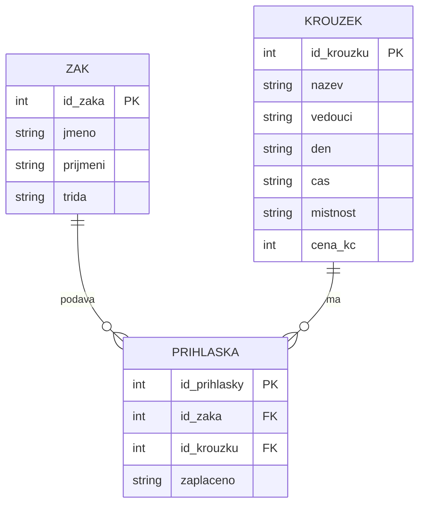

# SP1 Kroužky

**Kód žáka:** K07

## Co bolí na původní tabulce
* **Duplicita a redundance dat:** Informace o kroužcích (název, vedoucí, den, čas, místnost, cena) se zbytečně opakují na každém řádku přihlášky. Pokud se změní cena kroužku, musí se složitě přepisovat na mnoha místech.
* **Nejednotnost formátu zápisu:** Stejné hodnoty jsou pokaždé napsané jinak, například názvy kroužků (*Robotika / robotika / ROBOTIKA*), jména vedoucích (*Horák / Mgr. Horák*) nebo ceny (*600 / 600 Kč*).
* **Nespolehlivost datových dotazů:** Z původní tabulky nelze přesně a spolehlivě zjistit základní informace (např. přesný počet nabízených kroužků), protože nejednotný zápis zkresluje výsledky.

## Klíče
* **zaci:** PK `id_zaka`
* **krouzky:** PK `id_krouzku`
* **prihlasky:** PK `id_prihlasky`, FK `id_zaka` → zaci, FK `id_krouzku` → krouzky

## ER diagram



## SQL dotaz
```sql
SELECT nazev, cena_kc 
FROM krouzky 
WHERE cena_kc > 500;
```
