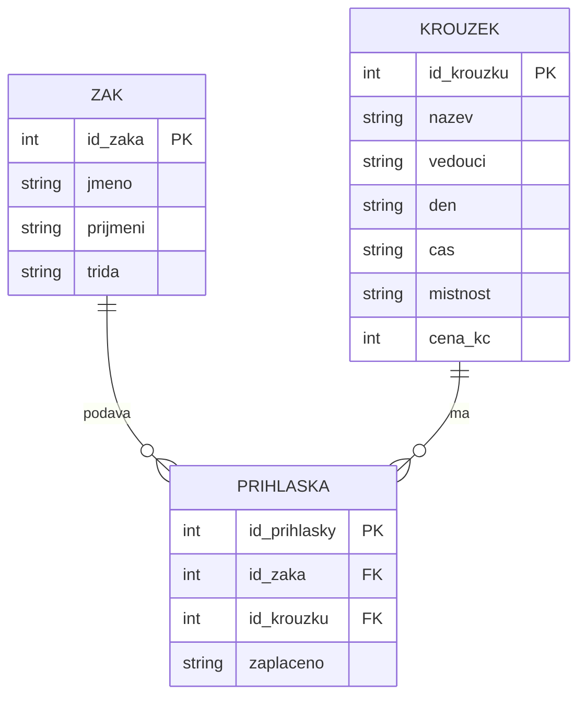

# SP1 Kroužky

**Kód žáka:** K07

## Co bolí na původní tabulce
* **Duplicita a redundance dat:** Informace o kroužcích (název, vedoucí, den, čas, místnost, cena) se zbytečně opakují na každém řádku přihlášky. Pokud se změní cena kroužku, musí se složitě přepisovat na mnoha místech.
* **Nejednotnost formátu zápisu:** Stejné hodnoty jsou pokaždé napsané jinak, například názvy kroužků (*Robotika / robotika / ROBOTIKA*), jména vedoucích (*Horák / Mgr. Horák*) nebo ceny (*600 / 600 Kč*).
* **Nespolehlivost datových dotazů:** Z původní tabulky nelze přesně a spolehlivě zjistit základní informace (např. přesný počet nabízených kroužků), protože nejednotný zápis zkresluje výsledky.

## Klíče
* **zaci:** PK `id_zaka;jmeno;prijmeni;trida
1;Adam;Novák;IT2
2;Eva;Nováková;IT2
3;Jan;Procházka;IT2
4;Petr;Černý;IT2
5;Marie;Kučerová;IT2
6;Josef;Marek;IT2
`
* **krouzky:** PK `id_krouzku;nazev;vedouci;den;cas;mistnost;cena_kc
1;Robotika;Mgr. Horák;čt;14:00;13;600
2;Fotografie;Veselá;út;15:00;210;450
3;Šachy;Ing. Beneš;po;14:00;207;300
4;3D tisk;Král;st;14:00;13;800
`
* **prihlasky:** PK `id_prihlasky;id_zaka;id_krouzku;zaplaceno
1;1;1;ano
2;2;1;ano
3;3;1;ne
4;1;2;ano
5;2;3;ano
6;3;4;ano
7;4;1;ne
8;5;2;ano
9;6;3;ano
10;4;4;ano
11;5;1;ano
12;6;2;ne
`, FK `id_zaka` → zaci, FK `id_krouzku` → krouzky

## ER diagram



## SQL dotaz
```sql
SELECT nazev, cena_kc 
FROM krouzky 
WHERE cena_kc > 500;
```
